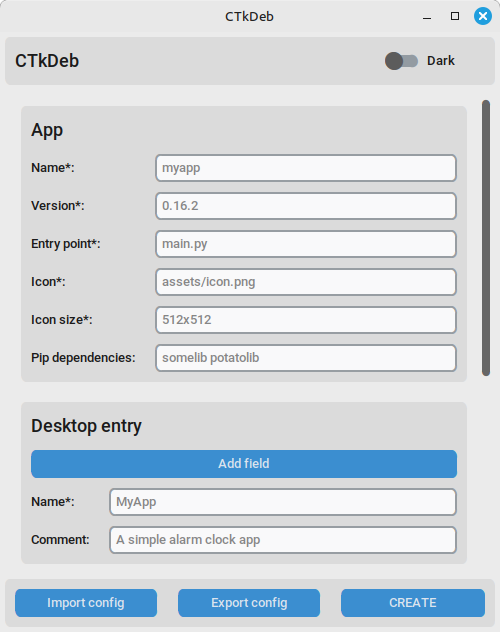

# CTkDeb


<p align="center">
    
</p>

The easiest way to create a DEB of your CustomTkinter project! You can create a small DEB without deep packaging experience.

## Install

```bash
pip install CTkDeb[gui]
```

Packaging requires the `dpkg-deb` tool (it is pre-installed on most Debian-like systems, so you probably won't need to install it separately).

## Run

Run this in the project folder (relative to which the paths in the config are specified)

```
ctkdeb-gui
```

## GUI



## CLI

```
ctkdeb config.json
```

View all arguments:

```
ctkdeb --help
```

## Python

```python
from ctkdeb import Packager

packager = Packager("config.json")
packager.create_deb()
```

Arguments:

| Argument | Type | Description |
|-|-|-|
| **json_path** | *str* | Path to the JSON config, required |
| **project_folder** | *str* | Path to the project folder (if the command is not executed from it) |
| **desktop_entry** | *str* | Path to the custom desktop entry (or its text) |
| **output_folder** | *str* | Path to the output folder |

## FAQ

- Do I need to specify Tkinter and CustomTkinter as dependencies?

No, CTkDeb has already taken care of that; just specify third-party dependencies, if any.

## Other

App icon: Claude Sonnet 5.
